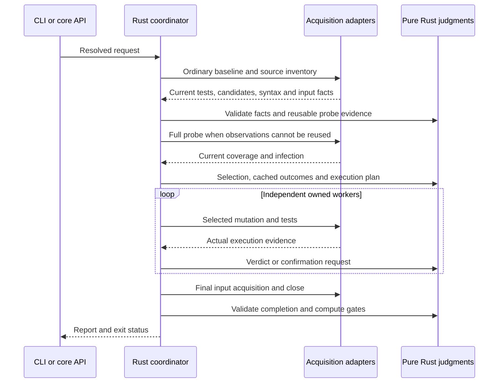

# Mutation execution and change boundaries

Mutation execution has one native coordinator and replaceable acquisition
adapters. Keep verdict rules independent of compiler objects, filesystem reads
and runner processes.

| Responsibility | Current entry points | Owned output |
| --- | --- | --- |
| Resolve CLI/API/configuration | `src/bin/errspec/cli.rs`, `src/bin/errspec/mutation/api.rs`, `src/bin/errspec/mutation/config.rs` | `mutation::options::Options` |
| Parse source and generate switches | `src/bin/errspec/mutation/source/mod.rs`, `src/bin/errspec/mutation/source/` | Candidates and source-bound syntax metadata |
| Acquire compiler/runner execution | `packages/mutation-driver/` and embedded analysis adapter | Execution, registration, coverage, infection and input facts |
| Select, reuse and judge | `src/mutation/` | Selected keys, reusable evidence, verdicts and gates |
| Own processes and persist files | `src/bin/errspec/mutation/run.rs`, `src/bin/errspec/mutation/run/worker_pool.rs`, `src/bin/errspec/mutation/ownership.rs`, `src/bin/errspec/mutation/cache.rs` | Validated requests, stopped workers and atomic cache documents |

The coordinator is intentionally the place where these operations meet. New
selection or verdict rules belong in `src/mutation/`; new file traversal belongs
with acquisition. A second runner should translate its facts into the existing
execution contract before introducing another verdict loop.

## Coordinator phases and ownership

`run.rs` handles the public command entry, interruption registration and final
report completion. Its `run_inner` sequences private phases under `run/`:

| Module | Input and owned result |
| --- | --- |
| `configuration` | Validate the request, recover owned workers and acquire Git/acceptance inputs; return configuration and the common budget start time |
| `session` / `driver` | Materialize embedded assets and open the validated driver protocol; own the process and its temporary directory |
| `prepare` / `prepare::inventory` | Acquire candidates, syntax, ordinary baseline and probe; return current evidence, cache store and fingerprint projections |
| `plan` | Apply key/Git/shard selection, coordinate typecheck acquisition/judgment and apply updates, attribute covering tests and rank test-selection requests |
| `typecheck` | Request typechecking through the driver, validate the envelope and decode owned facts without accessing the report |
| `execute` / `worker_pool` | Apply sampling/reuse and execute serial or parallel trials through the same confirmation and verdict functions |
| `finalize` | Close/reopen for final acquisition, compare Git inputs, merge worker facts, validate fingerprints, persist evidence and apply acceptance |

The request's report stays available across phase failures. Inventory acquisition
retains successful file/baseline evidence before checking later driver errors.
In sequential execution, sampling/reuse and each trial keep their original
per-candidate order, so a failed trial does not newly mark later rows as reused.
Parallel execution prepares its queue first and restores result order by index.

`Session` drops its driver before its temporary resources. Trial execution binds
the resources before moving the driver, preserving that order on early errors;
the worker pool joins owned workers before returning or deleting their files.
Finalization runs only after successful trial coordination, and marks completion
only after the existing close/input/cache checks. No public protocol, cache
eligibility, deadline, retry or concurrency default changes with this extraction.
Native source changes still invalidate the build-fixed engine fingerprint.

## Typecheck acquisition, judgment, and report application

`run/typecheck.rs` sends the selected keys in report order, including keys that
the compiler adapter excludes, with the existing unlimited total deadline and
120-second progress-stall deadline. It validates timeout/driver errors, the single
`typechecked` response, outcomes array, allowed messages and terminal count, then
decodes `TypecheckInfo`. It returns `mutation::typecheck::Facts`; missing, invalid,
and explicit null candidate fields remain distinguishable.

`src/mutation/typecheck.rs` has no driver or report dependency. Call
`evaluate(expected_keys, facts)` with the selected non-ignored TypeScript keys.
Its `Evaluation` contains confirmed updates in response order and
`completion: Result<TypecheckInfo, Error>`. Key and compiler-fact validation stops
at the first invalid candidate. Completeness, aggregate counts and nonempty
compiler version are checked after all candidates. A pair of null facts emits no
update, preserving the candidate's existing status and reason.

`plan.rs` applies the updates before returning any completion error. It sets
`engine.typecheck` and the aggregate information only on success. Keep this order:
buffering updates does not make report changes atomic. An error in the second
candidate retains the first update; a final count mismatch retains every update.
When typechecking is disabled, skip acquisition and report application entirely.

Change compiler/process integration in acquisition, fact interpretation in the
library, and report application in the coordinator. Pure judgment tests supply
owned values without starting processes or constructing reports. Report snapshots
captured before extraction check partial results and diagnostic precedence, while
Node integration tests exercise installed TypeScript versions, disabled checks,
weak mutation, parallel trials, cache reuse and shards. Preserve existing protocol,
JSON and diagnostic expectations when changing these boundaries. Source changes
invalidate old engine-bound caches once under the existing fingerprint rules;
subsequent compatible runs can reuse newly acquired evidence.

## Evidence that must survive a refactor

The ordinary baseline is current. A passing case cannot conceal a failed module
or cleanup error. Acquired syntax includes a digest of the exact source, ranges
and ownership; stale or malformed facts stop selection.

Result caching stores first-attempt assertion evidence before acceptance and
gating. Timeouts, runtime errors, retries and typechecks are revalidated.
Coverage reuse requires complete compatible registration and rebinds current
task IDs. Scope reuse refreshes the full probe after edits and compares both
old and current test-file cohorts. Unknown entry evidence revalidates. Anonymous
default declarations keep their unowned bodies in module inputs; compiler
comments currently bind the entire raw file.

Raw input validation still runs after an all-hit request. Dependencies,
configuration, environment and unacquired compilation callbacks participate in
the decision. Cache uncertainty cannot create a detected outcome.

Worker ownership is separate from verdicts. Each worker has a private request
identity and process group. Recovery authenticates a live supervisor; a saved
PID alone never authorizes a signal. Cancellation joins workers before their
temporary files disappear.

Partial budgets leave pending candidates and an unknown overall score. Cached
first-detection records are insufficient for a complete kill matrix.

## Verification and later extraction

Pure Rust tests exercise the rules with owned facts. Node integration tests use
real compiler/runner APIs, stateful fixtures and process interruption. Installed
tarballs repeat the public flow on Linux x64 and both macOS architectures. Keep
these levels when moving a responsibility.

Later repository extraction can follow the same boundaries: pure models and
judgments, acquisition adapters, then CLI/package integration. Preserve the
versioned protocol, engine fingerprint and end-to-end fixtures across each move.
