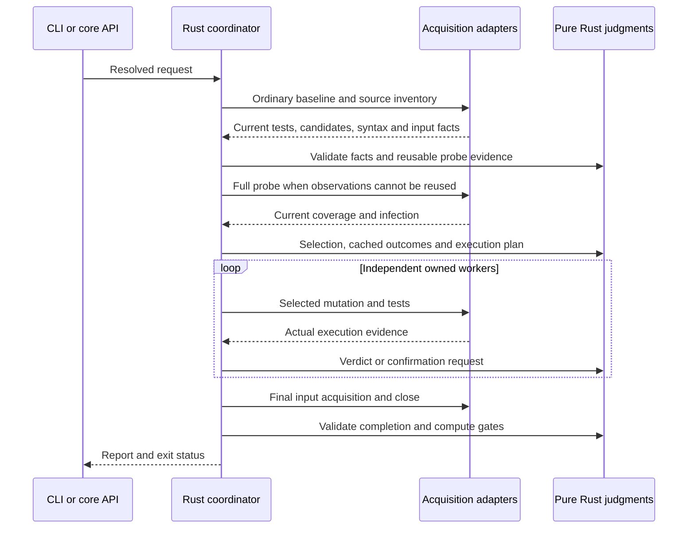

# Mutation execution and change boundaries

Mutation execution has one native coordinator and replaceable acquisition
adapters. Keep verdict rules independent of compiler objects, filesystem reads
and runner processes.

| Responsibility | Current entry points | Owned output |
| --- | --- | --- |
| Resolve CLI/API/configuration | `src/bin/errspec/cli.rs`, `src/bin/errspec/mutation_api.rs`, `src/bin/errspec/mutation_config.rs` | `mutation::options::Options` |
| Parse source and generate switches | `src/bin/errspec/mutation_source.rs`, `src/bin/errspec/mutation_source/` | Candidates and source-bound syntax metadata |
| Acquire compiler/runner execution | `packages/mutation-driver/` and embedded analysis adapter | Execution, registration, coverage, infection and input facts |
| Select, reuse and judge | `src/mutation/` | Selected keys, reusable evidence, verdicts and gates |
| Own processes and persist files | `src/bin/errspec/mutate.rs`, `src/bin/errspec/mutate/worker_pool.rs`, `src/bin/errspec/mutation_ownership.rs`, `src/bin/errspec/mutation_cache.rs` | Validated requests, stopped workers and atomic cache documents |

The coordinator is intentionally the place where these operations meet. New
selection or verdict rules belong in `src/mutation/`; new file traversal belongs
with acquisition. A second runner should translate its facts into the existing
execution contract before introducing another verdict loop.

## Evidence that must survive a refactor

The ordinary baseline is current. A passing case cannot conceal a failed module
or cleanup error. Acquired syntax includes a digest of the exact source, ranges
and ownership; stale or malformed facts stop selection.

Result caching stores first-attempt assertion evidence before acceptance and
gating. Timeouts, runtime errors, retries and typechecks are revalidated.
Coverage reuse requires complete compatible registration and rebinds current
task IDs. Scope reuse refreshes the full probe after edits and compares both
old and current test-file cohorts. Unknown entry evidence revalidates. Anonymous
default declarations keep their unowned bodies in module inputs; compiler
comments currently bind the entire raw file.

Raw input validation still runs after an all-hit request. Dependencies,
configuration, environment and unacquired compilation callbacks participate in
the decision. Cache uncertainty cannot create a detected outcome.

Worker ownership is separate from verdicts. Each worker has a private request
identity and process group. Recovery authenticates a live supervisor; a saved
PID alone never authorizes a signal. Cancellation joins workers before their
temporary files disappear.

Partial budgets leave pending candidates and an unknown overall score. Cached
first-detection records are insufficient for a complete kill matrix.

## Verification and later extraction

Pure Rust tests exercise the rules with owned facts. Node integration tests use
real compiler/runner APIs, stateful fixtures and process interruption. Installed
tarballs repeat the public flow on Linux x64 and both macOS architectures. Keep
these levels when moving a responsibility.

Later repository extraction can follow the same boundaries: pure models and
judgments, acquisition adapters, then CLI/package integration. Preserve the
versioned protocol, engine fingerprint and end-to-end fixtures across each move.
