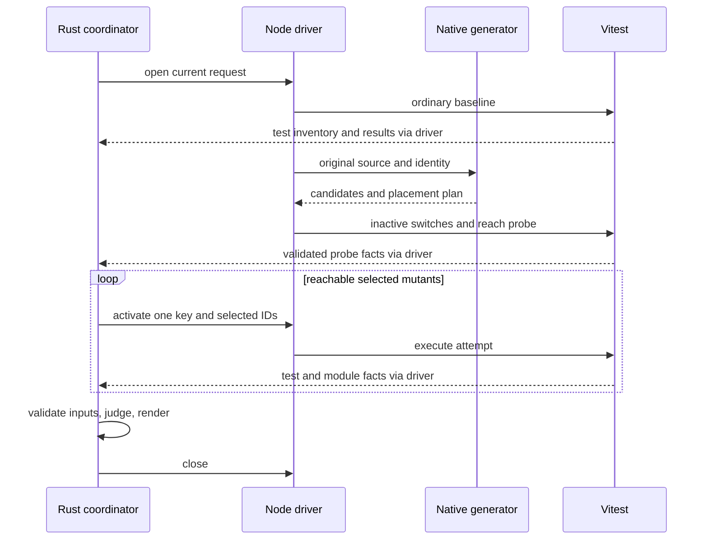

# Vitest mutation execution design

This design implements the [requirements](requirements.md) and [Product](../../product.md). Rust owns candidates, validated evidence, verdicts, and gates. A Node adapter acquires runner facts and performs in-memory transformations through the project's Vitest. Later selection/cache/typecheck/plugin/runner/report work is specified in the [workflow design](../mutation-workflows/design.md); the scenario verifier's evidence contract is unchanged.

## Boundaries and sequence

| Component | Responsibility |
|---|---|
| Rust CLI/coordinator | Validate requests, start drivers, sequence baselines/trials, select exit status |
| tsrs adapter/generator | Parse runtime syntax and acquire candidate/placement facts |
| Node driver | Resolve Vitest, enumerate source/tests, emit transformed text/maps, execute tests |
| Worker runtime | Track active key and per-test/module hit counts for the current request |
| Rust judgments/reporting | Judge owned validated values and convert them into output |

Use the [Rust guide](../../../../engineering/guidelines/rust-code.md). Generic AST position access belongs to the adapter; runtime selection and switch placement belong to mutation generation. Do not repurpose scenario-specific `TestRun` or `ObservationJudgments` for different mutation evidence.

1. Resolve root, Vitest, source/tests, and fingerprints.
2. Run ordinary unmodified tests. Failure or zero runnable tests stops trials. Retain module/assertion causes and failed-file attribution even if other tests pass.
3. Generate candidates and transformed text for every selected file, including unimported files.
4. Run an inactive probe and compare test inventory/outcomes with the ordinary baseline. Normalize project/file identity; enumeration order alone is not an inventory change. Actual test scheduling remains the runner's choice.
5. Map candidates to covering tests. Broaden ambiguous reach. Mark truly unreached keys `NoCoverage` without a trial.
6. Activate one candidate per trial, perform any confirmation, and judge.
7. Revalidate fingerprints, assemble the report, and release driver/temporary resources.

The initial mode uses fresh sessions for ordinary baseline, probe, and each attempt, with Vitest 5 `fsModuleCache` disabled. Reuse transformed text within the run. Global setup sees original code; worker execution sees switches. Opt-in session/cache reuse has additional conditions in the workflow design.

## Runtime syntax and candidate order

A syntax-only adapter entry uses `tsrs_parser` pinned to the existing compiler revision. It does not change semantic `TsrsAdapter::open`, type-error, or `noCheck` rules. Traverse runtime expressions/statements, excluding types, ambient declarations, decorators, import/reexport specifiers, and directives. For `as`/`satisfies`, traverse only the expression. Return annotations supply `FnValue` choices but are not mutated.

The [fixed reference](../../mutator-coverage.md) anchors these rules. Table order defines family order; enumeration within a row defines replacement order.

| Family | Changes and conditions |
|---|---|
| `ArithmeticOperator` | Exchange `+`/`-` and `*`/`/`; replace `%` with `*`. Exclude `+` concatenating string literals/templates. |
| `ArrayDeclaration` | Nonempty arrays become `[]`; empty arrays become `["errspec"]`. `Array(...)`/`new Array(...)` lose arguments, or gain an `[]` argument when empty. |
| `ArrowFunction` | Expression body becomes `undefined`, unless already `undefined`. |
| `AssignmentOperator` | Exchange `+=`/`-=`, `*=`/`/=`, `<<=`/`>>=`, `&=`/`\|=`, `&&=`/`\|\|=`; replace `%=` with `*=`, `??=` with `&&=`. Exclude arithmetic forms with a string-literal RHS. |
| `BlockStatement` | Nonempty body becomes `{}`. Exclude placements unable to preserve inactive behavior, including relevant derived-constructor `super()` cases. |
| `BooleanLiteral` | Exchange `true`/`false`; replace `!value` with `value`. |
| `CallExpression` | Standalone call statement becomes `;`, excluding directives/`super()`. Deduplicate equivalent deletion candidates. |
| `ConditionalExpression` | if/ternary conditions become `true` and `false`; loop conditions become `false`, including insertion for an empty for condition. Comparisons/logical expressions outside conditions also get constant choices, without parent duplicates. |
| `EqualityOperator` | `<` → `<=`,`>=`; `<=` → `<`,`>`; `>` → `>=`,`<=`; `>=` → `>`,`<`; exchange `==`/`!=` and `===`/`!==`. |
| `FnValue` | Replace a body with a return value selected from an explicit return annotation, as below. |
| `LogicalOperator` | Exchange `&&`/`\|\|`; replace `??` with `&&`. Preserve short-circuiting and precedence with parentheses. |
| `MethodExpression` | Replace `charAt`, `filter`, `reverse`, `slice`, `sort`, `substr`, `substring`, `trim` calls with their receiver. Exchange `endsWith`/`startsWith`, `every`/`some`, case-conversion pairs, `trimEnd`/`trimStart`, `min`/`max`. Exclude computed names. |
| `ObjectLiteral` | Nonempty object literal becomes `{}`. |
| `OptionalChaining` | Remove optionality from property/computed access and calls where receiver-preserving placement is possible. |
| `Regex` | Literal or constant-pattern/flags `RegExp`: remove anchors, invert character categories, toggle class negation, remove quantifiers, or fix bounded ranges to their lower bound. Preserve flags and accept only valid Node regexes. |
| `StringLiteral` | Nonempty string/template becomes empty; empty becomes `"errspec"`. Exclude noncomputed keys, import specifiers, JSX attributes, require/Symbol arguments, and tagged templates. |
| `UnaryOperator` | Exchange unary `+`/`-`; remove `~`, with lexical separation to avoid accidental `++` tokens. |
| `UpdateOperator` | Exchange prefix/postfix `++`/`--`. |

Case-conversion pairs are `toLowerCase`/`toUpperCase` and `toLocaleLowerCase`/`toLocaleUpperCase`. Regex generation understands escapes/classes/group names/backreferences instead of arbitrary string substitution. Dynamic constructor flags are unsupported.

`FnValue` chooses boolean `true,false`; number `0,1,-1`; string `"","xyzzy"`; bigint `0n,1n`; corresponding null/undefined/void values; and `[]` for `T[]`, `readonly T[]`, `Array<T>`, or `ReadonlyArray<T>`. Traverse parenthesized/union annotations and use literal-type values. Non-asserts predicates are boolean. Do not resolve aliases, instantiate generics, or synthesize arbitrary objects. Async functions use explicit `Promise<T>`'s T; synchronous `Promise<T>` returns wrap choices in `Promise.resolve`. Exclude generators, constructors, accessors, unchanged returns, and a duplicate `return undefined`/empty-body edit.

## Safe inactive switching

Record edit range separately from the enclosing runtime expression/statement/body switch range. Build a placement tree so an active parent mutation does not evaluate child switches. Identical range/replacement pairs use the earlier family.

Evaluate the original branch once. Do not wrap only a callee or assignment reference. Preserve `this`, short-circuiting, await/yield, labels, ASI, directives, and `super()` order. Unsafe candidates are `Ignored` with reasons. Keep original formatting except required insertions/replacements. Empty for conditions use insertion while retaining labels; AST directive boundaries determine body guards even with comments/omitted semicolons.

Keys are SHA-256 of a JSON tuple containing root-relative file, syntactic owner identity, owner-relative AST path, family, and replacement. Byte positions and temporary paths are excluded. Keep content, positions, and rule version separately. Key stability alone does not establish cache validity.

## Positions, emission, and validation

Rust uses half-open UTF-8 byte ranges and shared `Location`. The driver scans code points once to map byte boundaries to JS UTF-16 indices. Split-character boundaries are invalid. MagicString emits edits and high-resolution source maps using original coordinates, `source`, and `includeContent: true`. Preserve BOM, shebang, directive prologue, CRLF, and supplementary Unicode.

Reparse transformed text using the same ScriptKind before registration. Invalid emission is an instrumentation failure, never a kill. If an earlier Vite transform supplies text different from registered source, reject unsupported ordering/input change rather than guessing original positions.

The shared driver batches pure source generation and emitted-text validation into
one-shot native parser children. Each invocation handles at most eight requests;
the driver splits at 1 MiB of serialized request input, except that an individually
larger file keeps its existing isolated path. Compiler arenas die with the child,
so batching does not introduce an unbounded persistent parser. The internal batch
envelope authenticates the compiled engine fingerprint, preserves request order,
and returns independent success/error results. The existing single-source entry
and public CLI/JSON contracts remain unchanged.

Every emitted file is still parsed. A syntax failure takes the existing individual
placement checks, while engine/protocol failures stop acquisition. If aggregate
output exceeds the 64 MiB transport buffer, retry files individually; a transport
limit must not silently discard candidates. Plugin visitors keep their original
per-source execution and input acquisition. This optimization changes neither
ordinary/probe baselines nor cache eligibility or final input validation. The
[emitter acceptance](../../../../../tests/mutation-emitter.test.mjs) compares full
individual/batched results, mixed syntax failures, ordering, process counts, byte
bounds, fingerprint failures and malformed responses. The reproducible
[throughput benchmark](../../../../../scripts/benchmark-mutation-source.mjs)
asserts complete result equality separately from runner wall time.

## Vitest acquisition and coverage

Use Vitest 5's public `createVitest`, `globTestSpecifications`, `runTestSpecifications`, and result APIs. The initial validation baseline was 5.0.5; required APIs and major version are checked at startup. Current pinned adapter evidence is in [implementation status](../../implementation-status.md).

Install an `enforce: pre` Vite transform in the selected Node project. Prepare worker runtime before user setup. Do not merge controller/native-require/arbitrary-child execution into worker reach. `provide`/`inject` carries run ID, request ID, active key, and hit limit. A private Symbol holds current runtime. Switches record hits before choosing original/active branches.

Store per-test counts in test metadata and module/static/total counts in module metadata. Keep unattributed reach as broader reach. Reject mismatched run/request IDs. Disable watch, automatic snapshot updates, external coverage provider, and user reporters in favor of internal acquisition. Use forks, isolation, one runner worker, and no file parallelism per driver. Preserve aliases, environment, user setup, and ordinary retry settings, except explicit complete-matrix acquisition overrides in the workflow design. All changes are in memory.

Test identity is a JSON tuple of selected project, relative file, full name, and duplicate registration ordinal, separate from ephemeral Vitest task ID. Retries retain identity and use final results; early exit follows final failure. Sequential reach is per-test. Ambiguous concurrent reach expands to all runnable tests in that file; static reach expands to importing files, or the suite if attribution is unavailable. Report precision as `test`, `file`, or `suite`.

Only a valid zero-hit key becomes `NoCoverage`; missing acquisition or unknown keys are errors. Baseline skip/todo tests are outside runnable targets, but newly skipped targets cannot pass a mutant.

## Pure verdicts and deadlines

Rust judgments accept validated current candidates, baseline/reach, selected IDs, and attempt values without accessing runner objects or files. Apply this precedence:

1. Invalid protocol, input version, or IDs makes the run incomplete.
2. A final selected-test failure other than timeout/hit-limit is `Killed`, even if early exit leaves other targets unrun.
3. A hit-limit-only stop is `Timeout` directly. Elapsed/test/hook timeouts require one extended confirmation.
4. Module initialization errors, non-test exceptions, or missing selected registration/execution require one same-condition confirmation; reproducible failure is `RuntimeError`.
5. Only success of all selected tests is `Survived`.

At most one retry is allowed. A retry producing `Killed`/`Survived` wins. Changing between unconfirmed timeout/runtime failure classes produces EC_MUTATION_RUNNER and `Pending`.

With selected probe durations sum and max, total deadline is `1.5 * sum + 5000 ms`; no-progress stall is `3 * max + 10000 ms`. Initialization-only candidates use corresponding file duration. Hit limit is max(100 × baseline candidate hits, 10,000). A timeout retry triples total/stall and test/hook limits from original settings. Ordinary baseline uses project limits and supports interruption. An independent assertion failure takes precedence over a simultaneous timeout, with both reasons retained.

Rust also enforces trial deadlines when a synchronous loop blocks the driver/worker. Stop the owned process group, confirm termination, and retry with a new driver. Unexpected disappearance/corrupt communication is not reclassified as timeout.

## Sequence and owned model



The generator is a short-lived process per file and releases its compiler arena on exit. Native handles never cross JSON boundaries.

| Value | Contents |
|---|---|
| `MutationRequest` | Root, source/exclusion selection, runner settings, gate options |
| `MutationInput` | Relative file, source/test/config/lock/local-dependency fingerprints, rule version |
| `Mutant` | Key, family, byte span/Location, original/replacement, placement, exclusion reason |
| `MutationTest` | Stable tuple ID, task ID, registration ordinal, final state, duration |
| `ValidatedMutationBaseline` | Run ID, ordinary/probe outcomes, test inventory, reach/static facts and precision |
| `ValidatedMutationAttempt` | Run/request/key/selected IDs, execution states, test/module results, deadline reason |
| `MutationJudgment` | Verdict, reasons, attempts |
| `MutationReport` | Completion, baseline, verdicts, summary, gate, diagnostics, engine versions |

Validate run IDs, rules, fingerprints, and candidate/target references before pure judgment. Scheduled target IDs must match the request. A valid request with missing execution records goes through confirmation of missing execution, distinct from invalid protocol. Shared `Finding`/`Location` remain common; mutation states use dedicated enums.

## CLI and output compatibility

```sh
errspec mutate
errspec mutate --root packages/api --include 'src/**/*.ts' --vitest-project api
errspec mutate --exclude 'src/generated/**' --exclude-mutator Regex --format json
errspec mutate --fail-on-undetected
```

Root defaults to caller cwd. Default include is `src/**/*.{ts,tsx,mts,cts,js,jsx,mjs,cjs}`. Includes/excludes/excluded families can repeat. Always exclude node_modules, declaration files, and collected tests/config/setup. Resolve explicit relative paths from caller cwd, globs from root, and source symlinks to in-root nondependency files. Sort/deduplicate relative source paths. Unknown families are configuration errors.

`--vitest-config`, `--vitest-project`, and `--vitest-package` retain their existing meaning; project omission with multiple Node projects is rejected with choices. Package discovery uses project/parent node_modules. `--node` defaults to PATH and requires Node 24 for mutation. `--format text|json` defaults to text. `--fail-on-undetected` defaults off. Contract `--config`, `--baseline`, and `--strict-baseline` are rejected for mutation when explicitly supplied; parser defaults are distinguished from explicit input.

Native JSON is `kind: "errspec/mutation"`, schemaVersion 1. Core fields are engine, runComplete, ok, testsExecuted, baseline, summary, mutants, gate, and diagnostics. Initial engine fields identify tsrs/rules, acquired Node/Vitest versions, `typecheck: "not_run"`, and `vitest_vite_workers` measurement scope. Unacquired versions are null; optional workflow fields preserve default omission contracts.

Completed score is `(Killed + Timeout + RuntimeError) / (Killed + Survived + NoCoverage + Timeout + RuntimeError)`. It is a 0–1 ratio in JSON and percentage in text. Zero denominator, incompletion, or selected Pending yields null. Do not use a sampled/budget-limited subset to pass a full-run gate. Covered/killed tests follow inventory order. Module failures remain `failedModules`, not invented test IDs.

Disabled/incomplete gates have `passed: null`; a completed enabled strict gate fails survivors/unreached/unexecuted targets with EC_MUTATION_UNDETECTED. `ok` requires completion, successful baseline, no error, and no failed gate. `testsExecuted` requires actual test start, not just failed module initialization.

| Exit | Meaning |
|---|---|
| 0 | Completed baseline/trials and no requested gate failure |
| 1 | Completed quality-gate failure |
| 2 | Configuration, baseline, instrumentation, runner, protocol, or changed-input incompletion; takes precedence over gate |
| 130 / 143 | SIGINT / SIGTERM interruption; any partial report remains incomplete |

Diagnostics distinguish EC_MUTATION_CONFIG, BASELINE, INSTRUMENTATION, RUNNER, PROTOCOL, and INPUT under the EC_MUTATION prefix. Candidate order is relative file, original byte start, family order, then replacement order. Text uses the same verdict values and logs stay off JSON stdout.

## Protocol, resources, and alternatives

Versioned newline-delimited JSON carries `open`, `prepare`, `run`, `close`, run/request IDs, and counted completion messages. Unknown/duplicate/mismatched replies fail. The same native binary's hidden generator parses original UTF-8 and validates transformed source on a 32 MiB analysis thread, returning owned values and exiting. Panics/corrupt replies make the run incomplete.

Bundle ESM driver/setup and pinned MagicString dependencies (initially 1.4.5), notices included. Import the project's Vitest by absolute entry; never bundle/download another Vitest. Users need no JS build or Rust toolchain. Node 24 applies to mutation, while legacy launcher/testkit Node 22 compatibility is preserved.

Keep original source/config/tests/lock/acquired dependencies fingerprinted before/after trials. Separate public relative paths from canonical I/O paths. Transformations/maps/live driver files remain temporary/in memory. Opt-in persistent history/report output is covered by the workflow design, never scenario-history migration.

Use argv arrays without shell expansion, mutation-specific environment names separate from testkit, and protocol-only stdout. Tests/configuration are trusted local code. Run IDs/fingerprints prevent accidental mixing, not hostile forgery. Linux/macOS owned process groups contain drivers/workers/generators; only these groups are stopped before reap/retry. Stronger supervisor ownership is detailed in the workflow design.

In-memory Vite transformation avoids rewrite/restore hazards during concurrent edits or interruption. Existing verify reports lack active keys/reach/retries/module failures, so mutation needs its own evidence model. A native persistent ABI could reduce startup cost but adds arena/ABI ownership; measure that cost before revisiting. No speed claim follows from implementation language.
