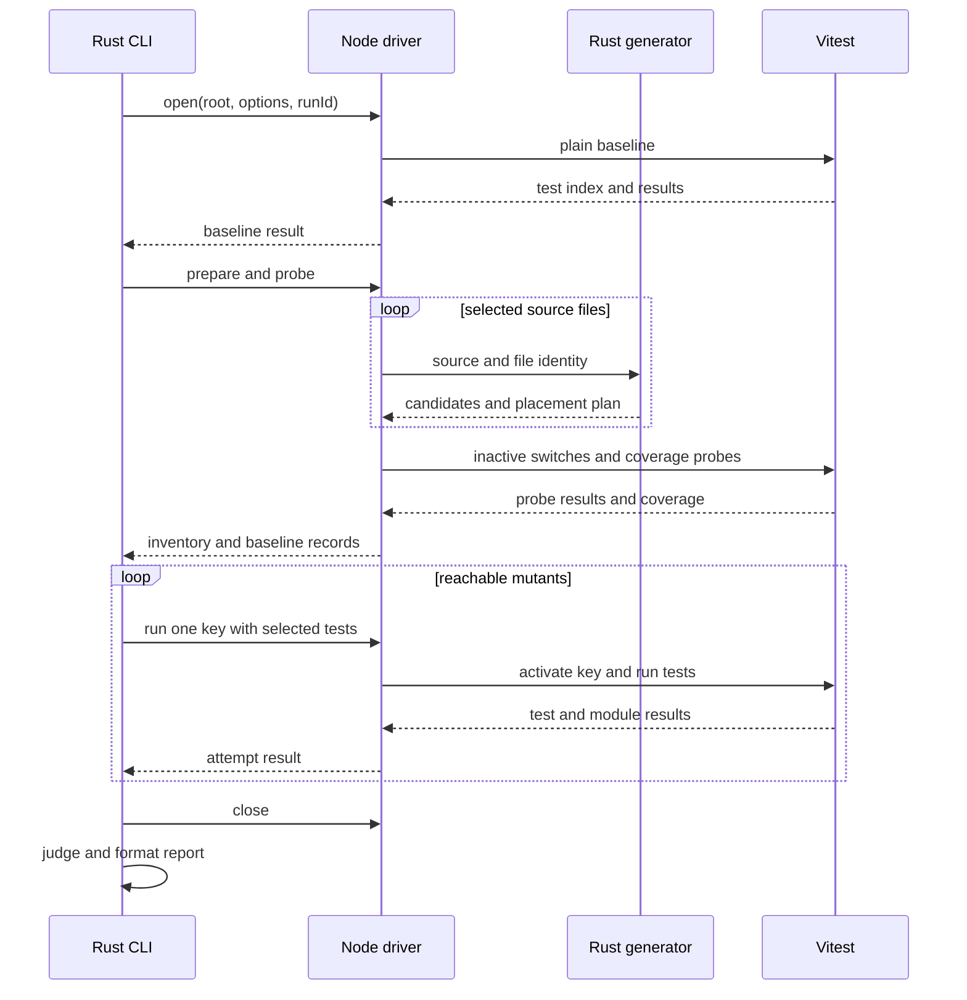

# Vitestによる変異の生成・実行・判定の設計

## このドキュメントについて

[Requirements](requirements.md)と[Product](../../product.md)に対応する設計です。Rustが候補と判定を所有し、利用先のVitestを動かすNode driverが、メモリ上のソース変換とテスト実行を担当します。`mutate`として実装しています。

### 対象読者

ミューテーションの生成器、実行器、レポートを実装・変更する開発者とAI。

### 前提知識

ASTの式・文、VitestのNode API、Viteのtransform、UTF-8とUTF-16の位置の違い。

### このドキュメントで扱わないこと

後続の差分実行、永続キャッシュ、weak mutation、型検査、plugin、追加ランナーの設計は扱いません。既存の契約・テスト・実行記録の照合規則も変更しません。

## 実装方針

新しい`mutate`コマンドを追加します。既存の`verify`や`coverage`へ変異実行を組み込まず、`errspec.json`の契約とは独立したリクエストと結果を使います。

| 役割 | 責任 |
| --- | --- |
| Rust CLI | 引数の検証、Node driverの起動、基準実行・変異実行の順序、終了コード |
| tsrs adapterと生成器 | 構文解析、実行時の式・文の選別、候補と配置計画の生成 |
| Node driver | 利用先のVitestの解決、対象ファイルの列挙、変換コードとsourcemap、テスト実行 |
| worker内のruntime | 今回の有効な変異、到達回数、テスト・モジュールごとの記録 |
| Rustの判定とレポート | 検証済みの入力値から状態と診断を返し、最後に出力形式へ変換 |

配置は[Rustコードとsnaptestの基準](../../../../engineering/guidelines/rust-code.md)に従います。ASTの汎用的な位置取得はadapterを使い、実行時の式・文だけを選ぶ規則と変異の配置はこの機能が担当します。既存の`evidence::TestRun`や`ObservationJudgments`を、異なる意味のミューテーション結果へ転用しません。

### 基準実行から結果まで

1. root、選択したVitest、対象ソースとテストを確定し、内容のfingerprintを保持する。
2. 変更前コードを使うplain基準実行を行う。失敗または実行可能テスト0件なら終了する。
3. 全対象ファイルの候補と変換コードを生成する。未importのファイルも含める。
4. 変異を一つも有効にせず、到達記録付きのprobe基準実行を行う。plainとのテスト一覧・成否の一致を確認する。
5. 到達したテストを候補に対応付ける。対応を限定できなければ範囲を広げる。未到達は実行せず`NoCoverage`とする。
6. 一つの候補だけを有効にして実行し、必要な再実行を終えてから判定する。
7. 入力のfingerprintを再確認し、結果を組み立てる。driverと一時データを解放して出力する。

変換コードは一回の検証内で再利用しますが、別の実行から結果や到達記録を取り込みません。Vitestセッションはplain・probe・各試行で作成します。Vitest 5の`fsModuleCache`を無効にし、前の変換結果による省略を防ぎます。global setupでは元のコード、workerでは今回の切替を使います。

### 候補の生成と18種の規則

プロジェクト全体の型検査を要求せずに構文解析します。既存と同じrevisionの`tsrs_parser`を直接依存へ追加し、adapterに構文解析専用の入口を設けます。`TsrsAdapter::open`の型検査や`noCheck`の規則は変更しません。

生成器は、ASTの種別と親子関係から実行時の式・文だけを巡回します。型の宣言、ambient宣言、decorator、import / reexportの指定、directiveは候補にしません。`as`、`satisfies`などは実行時の式をたどり、型部分は巡回しません。戻り値の型注釈は`FnValue`の値選択にだけ使います。

[機能対応表](../../mutator-coverage.md)の固定版を比較の基準とし、初回の規則を次のように定義します。行の順序を種別の順序とし、各行の列挙順を候補の順序に使います。

| 種別 | 生成する変更と条件 |
| --- | --- |
| `ArithmeticOperator` | `+`と`-`、`*`と`/`を交換し、`%`を`*`にする。文字列リテラルやtemplateを連結する`+`は対象外 |
| `ArrayDeclaration` | 要素がある配列を`[]`、空配列を`["errspec"]`にする。`Array(...)`と`new Array(...)`も、引数ありを引数なし、引数なしを`Array([])`相当へ変える |
| `ArrowFunction` | 式本体を`undefined`にする。すでに`undefined`なら生成しない |
| `AssignmentOperator` | `+=`と`-=`、`*=`と`/=`、`<<=`と`>>=`、`&=`と`\|=`、`&&=`と`\|\|=`を交換し、`%=`を`*=`、`??=`を`&&=`にする。算術系で右辺が文字列リテラルなら生成しない |
| `BlockStatement` | 空でない本体を`{}`にする。派生constructorの`super()`など、非有効状態の意味を維持できない配置は除外 |
| `BooleanLiteral` | `true`と`false`を交換し、`!value`を`value`にする |
| `CallExpression` | 単独の呼出文を`;`にする。directiveと`super()`は対象外。文内の別候補で同じ削除を調べる場合は重複を除く |
| `ConditionalExpression` | if・三項式の条件を`true`と`false`にする。loop条件は`false`だけにし、条件なしのforへ`false`を挿入する。条件の外の比較式・論理式にも定数化を適用し、親による同じ定数化と重複させない |
| `EqualityOperator` | `<`を`<=`と`>=`、`<=`を`<`と`>`、`>`を`>=`と`<=`、`>=`を`>`と`<`にする。`==`と`!=`、`===`と`!==`を交換 |
| `FnValue` | 明示した戻り値の型注釈から候補値を選び、本体をその値のreturnへ変える。値の選択は後述 |
| `LogicalOperator` | `&&`と`\|\|`を交換し、`??`を`&&`にする。短絡と演算子の優先順位を括弧で維持 |
| `MethodExpression` | `charAt`、`filter`、`reverse`、`slice`、`sort`、`substr`、`substring`、`trim`の呼出を受信オブジェクトにする。`endsWith`と`startsWith`、`every`と`some`、大文字化と小文字化、`trimEnd`と`trimStart`、`min`と`max`を交換。computed名は対象外 |
| `ObjectLiteral` | 空でないオブジェクトリテラルを`{}`にする |
| `OptionalChaining` | property accessの`?.`を`.`、computed accessとoptional callの`?.`を空にする。呼出の受信オブジェクトを維持できる範囲で配置する |
| `Regex` | リテラルと、定数pattern・flagsを持つ`RegExp`が対象。アンカーの除去、文字種の反転、文字クラスの否定切替、量指定子の除去、範囲指定の下限への固定を行う。flagsを維持し、実際のNodeで正規表現として成立する候補だけを採用 |
| `StringLiteral` | 空でない文字列・templateを空へ、空のものを`"errspec"`相当へ変える。非computedのキー、import指定、JSX属性、`require` / `Symbol`の引数、tagged templateは対象外 |
| `UnaryOperator` | 単項`+`と`-`を交換し、`~`を除去する。`++`などへ字句が変わらないよう区切る |
| `UpdateOperator` | 前置・後置それぞれの`++`と`--`を交換する |

`MethodExpression`の大文字化・小文字化は`toLowerCase` / `toUpperCase`と、`toLocaleLowerCase` / `toLocaleUpperCase`のそれぞれの組を指します。`Regex`は文字クラス内のescape・group名・後方参照を任意の文字列置換で変更しません。flagsが動的なconstructorは初回の対象から除き、対応していると報告しません。

`FnValue`はbooleanに`true, false`、numberに`0, 1, -1`、stringに`"", "xyzzy"`、bigintに`0n, 1n`、null / undefined / voidに対応する値、配列に`[]`を選びます。配列には`T[]`、`readonly T[]`、`Array<T>`、`ReadonlyArray<T>`を含めます。括弧型とunionをたどり、文字列などのliteral型はその値を使います。非assertsの型述語はbooleanとして扱います。別名の解決、genericの具体化、任意のオブジェクトの値の合成は行いません。

async関数は明示した`Promise<T>`の`T`を使います。同期関数が`Promise<T>`を返す場合は候補を`Promise.resolve`で包みます。generator、constructor、getter / setter、同じ値を返すだけの変更は除きます。block本体の`return undefined`は空本体と重複させません。

### 非有効状態の維持と変異の配置

生成器は、候補の置換範囲と、実行時に切り替える式・文・本体の範囲を別々に記録します。親子の配置を木として組み立て、親の変更が有効な場合は、その子の切替を評価しない計画にします。同じ範囲と置換内容が重複する場合は、表の先の種別を採用します。

式は元の値を一度だけ評価する切替にし、文や本体はその位置で成立する切替にします。呼出のcalleeや代入の左辺だけを包まず、`this`、短絡、await / yield、label、ASI、directive、`super()`の順序を維持します。維持できない候補は`Ignored`とし、理由を保持します。元の本文は再整形せず、必要な範囲への挿入・置換に限ります。

空のfor条件は式の挿入で表し、labelを維持します。本体のguard位置はAST上のdirectiveの末尾から決め、コメントやセミコロンの省略がある場合もdirectiveとしての意味を維持します。

識別子は、rootからの相対パス、所有する関数などの構文上の識別情報、所有単位内のAST経路、種別、置換内容のJSON tupleをSHA-256へ変換します。文字位置や一時ディレクトリをキーに含めません。候補の内容、位置、規則の版はキーとは別に保持します。永続キャッシュとしての有効性は保証しません。

### ソース位置とsourcemap

Rust内では半開区間のUTF-8 byte offsetを使います。開始位置には共通の`Location`を利用し、終了offsetを追加で保持します。driverはソースをコードポイント単位で一度走査し、byte境界からJavaScriptのUTF-16 indexへの変換表を作ります。区間境界が文字の途中なら入力異常にします。

編集とsourcemapの生成には[magic-string](https://github.com/Rich-Harris/magic-string/blob/master/README.md)を採用します。編集は元の文字位置を基準にし、`source`、`includeContent: true`、`hires: true`を指定します。BOM、shebang、directive prologueを維持し、CRLF、日本語、補助平面の文字を含む位置も同じ変換表で扱います。

変換後の本文を同じScriptKindで再解析してから登録します。生成した本文の構文不正は生成器の異常として終了し、検出済みの変異に数えません。Viteの先行変換で受け取った本文が登録した元の本文と異なる場合も、元ソースの位置を推測せず、非対応の変換順または入力変更として終了します。

### Vitestセッションと到達記録

[VitestのNode API](https://vitest.dev/guide/advanced/)で`createVitest`を使い、[実行API](https://vitest.dev/api/advanced/vitest)の`globTestSpecifications`、`runTestSpecifications`とテスト結果を利用します。基準版は5.0.5とし、5系以外や必要なAPIがない版は起動時に拒否します。

選択したNodeプロジェクトにViteの`enforce: pre`のtransformを登録します。未importのソースも事前に列挙し、同じ元ソースから生成したコードとキーを使います。worker内のsetupは利用者のsetupより前にruntimeを準備します。Nodeの制御プロセス、native require、別の子プロセスなど、Vite変換を経由しない実行をworkerの到達記録へ混ぜません。

driverはVitestの`provide`へrun ID、request ID、有効なkey、到達回数の制限を渡します。setupは同じVitestの`inject`から受け取り、run IDを持つruntimeをworkerの専用Symbolに登録します。切替はruntimeへ到達を記録してからkeyを比較し、probeでは元の式・文、変異実行では一致した一つの変更だけを評価します。

setupはテストのmetaへテスト単位の回数を、モジュールのmetaへ初期化時と全体の回数を記録し、Vitestの結果からdriverへ回収します。どのテストにも帰属しない到達も全体の記録へ保持します。run IDまたはrequest IDが違う記録は採用しません。

実行中はwatchとsnapshot更新を無効にし、coverage providerと利用者のreporterに代えて内部の記録器を使います。poolはforks、isolateはtrue、worker数は1、ファイルの並列実行は無効とします。alias、環境、利用者のsetupとテストのretry設定は維持します。この設定変更はメモリ上に限ります。

テストIDは、選択プロジェクト、相対ファイル名、full name、同名の登録順のJSON tupleです。Vitestのtask IDとは別に保持し、今回の一覧に対応させます。retryは新しいテストIDへ変換せず、最終結果を使います。early exitは最終的な失敗を確認してから行います。

到達は切替を配置した実行単位で記録します。逐次実行のテストはテスト単位、concurrentで分離できない記録は同じファイルの全実行可能テストへ対応付けます。初期化時の記録も、そのモジュールを読み込んだテストファイルへ広げます。対応が確定できなければ選択した全テストを実行します。結果の精度は`test` / `file` / `suite`で示します。

基準実行で一度も到達しなかったキーだけを`NoCoverage`にします。到達記録の取得失敗やキーの不一致は、到達0件として扱いません。基準実行のskip / todoは実行対象から除き、変異実行で新たにskipされた対象は成功としません。

### 判定と期限

判定はファイルやVitestのオブジェクトに触れないRust関数に集約します。入力は今回の候補、検証済みの基準実行・到達記録、選択したテストID、試行結果です。変異の状態は次の優先順で確定します。

1. プロトコル、入力の版、対象IDが不正なら実行全体を未完了にする。
2. timeoutと到達回数の制限による失敗を除き、対象テストの最終的な失敗があれば`Killed`。early exitで未実行の対象があっても、この検出は有効。
3. 到達回数の制限だけで停止した場合は`Timeout`。経過時間やVitestのtest / hook timeoutは、期限を延長して一度再実行する。
4. テストファイルの初期化失敗、テスト外の例外、対象テストの登録・実行の欠落は、同じ条件で一度再実行する。再現すれば`RuntimeError`。
5. 選択した全対象テストが成功した場合だけ`Survived`。

再試行は一候補につき一度までです。2回目が`Killed`または`Survived`ならその結果を採用します。時間切れと実行時エラーが入れ替わるなど、2回目にも別種の失敗しか確認できない場合は、`EC_MUTATION_RUNNER`と`Pending`にし、検出済みに数えません。

一回の実行期限は、probe基準実行の対象テストの合計時間を`sum`、最長時間を`max`として、totalを`1.5 * sum + 5000 ms`、進捗がない場合のstallを`3 * max + 10000 ms`とします。初期化だけの候補は対応するファイル全体の時間を使います。到達回数の制限は、当該候補の基準実行の回数の100倍と10000回の大きい方です。

時間切れの再試行ではtotal / stallとVitestのtest / hook timeoutを3倍にします。基準実行には利用先のtest / hook timeoutを使います。基準実行中も利用者の中断を受け付けます。任意の比較失敗とtimeoutが同時にある場合は、比較失敗による`Killed`を優先し、理由を併記します。

親Rustプロセスも変異実行の期限を管理します。driverやworkerが同期ループで応答できない場合は、自分が起動したプロセス群を終了し、新しいdriverで再試行します。driverの不意な消失や通信破損は`Timeout`へ変換しません。

## アーキテクチャ・シーケンス図



テスト実行中のruntimeはVitestのworker内にあります。Rust generatorはファイルごとの短命な子プロセスとし、コンパイラのarenaをプロセス終了で解放します。Node driverからgeneratorへの要求にネイティブハンドルを含めません。

## データモデル・ER 図

一つの検証が入力一覧、テスト一覧、候補一覧を所有します。候補とテストは到達記録で多対多に対応し、候補ごとの複数の試行から一つの判定を作ります。この関係は下表で表せるため、ER図は省略します。

| 値 | 主な内容 |
| --- | --- |
| `MutationRequest` | root、対象・除外、Vitest設定、選択プロジェクト、厳格指定。CLIの型を後段へ渡さない |
| `MutationInput` | 相対パス、元ソース・設定・テスト・lockfile・把握したローカル依存のfingerprint、規則の版 |
| `Mutant` | key、file、mutator、byte区間、元の`Location`、original、replacement、配置計画、任意の除外理由 |
| `MutationTest` | tuple ID、Vitest task ID、ファイル、登録順、最終成否、実行時間 |
| `ValidatedMutationBaseline` | run ID、plain / probeの状態、テスト一覧、到達・初期化時の記録と精度 |
| `ValidatedMutationAttempt` | run ID、request ID、key、対象ID、開始・完了、テストとモジュールの結果、期限の理由 |
| `MutationJudgment` | `Killed` / `Survived` / `NoCoverage` / `Timeout` / `RuntimeError` / `Ignored` / `Pending`、根拠、全試行 |
| `MutationReport` | 完了状態、基準実行、候補と判定、集計、gate、診断、環境の版 |

基準実行と試行は、run ID、規則の版、入力fingerprint、候補・対象IDの一致を検査してから判定関数へ渡します。未検証のJSONを直接照合しません。`Finding`と`Location`は共通モデルを利用し、ミューテーション固有の状態は専用のenumで保持します。

試行の応答が返す予定対象IDは、要求と一致することを必要とします。要求が一致していても、予定したテストの実行結果がない場合は、通信の不正と区別します。この場合は登録・実行の欠落を再確認する判定へ渡します。

## API・インターフェース

### 利用者のコマンド

```sh
errspec mutate
errspec mutate --root packages/api --include 'src/**/*.ts' --vitest-project api
errspec mutate --exclude 'src/generated/**' --exclude-mutator Regex --format json
errspec mutate --fail-on-undetected
```

上記のコマンドを提供します。

| 指定 | 意味と既定値 |
| --- | --- |
| `--root PATH` | 対象root。既定は呼出元の作業ディレクトリ |
| `--include GLOB` | 繰返し指定可能。既定は`src/**/*.{ts,tsx,mts,cts,js,jsx,mjs,cjs}` |
| `--exclude GLOB` | 既定の除外へ追加。`node_modules`、型宣言、収集したテスト・設定・setupは常に除外 |
| `--exclude-mutator NAME` | 繰返し指定可能。既定は除外なし。未知の名前は設定エラー |
| `--vitest-config PATH` | 明示したVitest設定。省略時はrootからVitestの設定探索を利用 |
| `--vitest-project NAME` | 一つのNodeプロジェクトを選ぶ。未指定で複数あれば候補名を示して拒否 |
| `--vitest-package PATH` | Vitestパッケージのディレクトリ。省略時はrootと親の`node_modules/vitest`から解決 |
| `--node PATH` | Node実行ファイル。省略時はPATHの`node`。24未満は起動前に拒否 |
| `--format text\|json` | 既存と同じ出力形式の選択。既定はtext |
| `--fail-on-undetected` | 生存・未到達があれば終了コード1。既定は無効 |

相対の明示パスは呼出元を基準に解決し、globはrootを基準にします。対象ソースのsymlinkは実体を確認し、root外や依存パッケージのソースを取り込みません。Vitestのパッケージと設定は明示パスや親ディレクトリからも利用できます。拡張子は対象の8種類に限り、`.d.ts` / `.d.mts` / `.d.cts`を除外します。ファイル一覧は相対パスでソートして重複を除きます。

既存の`--config`は契約設定の指定なので、このコマンドで明示された場合は拒否します。パーサー境界で既定値と明示入力を区別します。`--baseline`、`--strict-baseline`も拒否し、既存の各コマンドの解釈は変更しません。

### 結果の形式と終了コード

JSONは独立した`kind: "errspec/mutation"`、`schemaVersion: 1`を使います。必須のフィールドは`engine`、`runComplete`、`ok`、`testsExecuted`、`baseline`、`summary`、`mutants`、`gate`、`diagnostics`です。`engine`にはtsrs revision、規則の版、実際に利用したNode / Vitestの版、`typecheck: "not_run"`と、計測範囲`vitest_vite_workers`を持たせます。取得前に起動が失敗した環境の版はnullとします。

`summary`は全件数と状態ごとの件数、任意の`score`を持ちます。完了した場合の分母は`Killed + Survived + NoCoverage + Timeout + RuntimeError`、分子は`Killed + Timeout + RuntimeError`です。`score`は0から1の比率とし、textでは百分率に変換します。分母0件または未完了なら`score: null`とします。各候補の`coveredBy`と`killedBy`はテスト一覧の順に並べ、試行結果と除外理由も保持します。実行時エラーのモジュールは`failedModules`へ分け、テストIDとして混在させません。

`gate`は`enabled`と`passed`を持ち、無効または未完了なら`passed: null`です。有効かつ完了した場合だけ判定し、生存・未到達のいずれかがあればfalseと`EC_MUTATION_UNDETECTED`、どちらもなければtrueを返します。`ok`は完了・基準実行成功・エラーなし・gate不合格でない場合にtrueです。`testsExecuted`は実際のテスト開始を確認した場合にtrueとし、モジュール初期化の失敗だけでtrueにしません。

| 終了コード | 条件 |
| --- | --- |
| 0 | 基準実行と全候補の判定が完了し、指定したgateが不合格でない |
| 1 | 完了した結果に、生存・未到達があり、厳格指定によって不合格 |
| 2 | 設定、基準実行、生成、実行器、通信、入力変更などによる未完了。gateより優先 |
| 130 / 143 | SIGINT / SIGTERMによる中断。部分結果を出せる場合も`runComplete: false` |

診断は`EC_MUTATION_CONFIG`、`EC_MUTATION_BASELINE`、`EC_MUTATION_INSTRUMENTATION`、`EC_MUTATION_RUNNER`、`EC_MUTATION_PROTOCOL`、`EC_MUTATION_INPUT`で原因を区別します。候補は相対ファイル、開始byte offset、種別の表順、置換候補の順に並べます。textも同じ判定値から表示し、JSONのstdoutへログを混ぜません。

### 内部の実行要求

Rust CLIとNode driverは、stdin / stdout上の改行区切りJSONで`open`、`prepare`、`run`、`close`を受け渡します。各メッセージにprotocol version、run ID、request IDを持たせます。driverは結果をファイル単位・試行単位で返し、最後の完了メッセージと件数で欠落を検出します。未知の応答、重複、別のkey・IDは通信異常です。

driverは、同じCLIバイナリの非公開の生成用入口をファイル単位で起動します。生成要求は元のUTF-8ソースとファイルの識別情報から候補・配置計画を返し、検証要求は変換後ソースの構文診断を返します。生成器は32 MiBの解析スレッドを使い、結果を所有可能な値へ変換して終了します。生成器のpanicや不正な応答も未完了へ変換します。

## 外部サービスとの連携方式

検証中のネットワーク利用や自動インストールは設けません。NodeとVitestは利用先から解決し、Rust用のパーサーは既存のtsrs revisionへそろえます。

driverとsetupはESMとして同梱します。magic-string 1.4.5と必要な依存を版固定してbundleへ含め、Vitest自体はbundleせず利用先のentryを絶対パスでimportします。生成済みbundleをRustに含めるため、CLIの利用先でJSのbuildを要求しません。依存のライセンスは配布物の通知へ含めます。

Node 24の要件は`mutate`に限定します。既存npm CLIやtestkitのNode 22の要件を変更しません。実行APIの互換性を確認できない場合は、異なるVitestを自動取得するのではなく、診断と終了コード2を返します。

## データの取り扱い設計

元ソース・設定・テスト・lockfileと、Viteから把握できるローカル依存のfingerprintを開始時に保持し、各変異実行の前後に確認します。途中の内容変更は、以前の結果と混ぜず`EC_MUTATION_INPUT`にします。出力の相対パスと実ファイルのcanonical pathは別に保持します。

変換コード、sourcemap、driver用ファイルは今回の一時ディレクトリとメモリに保持します。元のソース、Vitest設定、errspecのシナリオ履歴を変更しません。一時ディレクトリはRust CLIが作成・所有し、成功・失敗・中断で解放します。結果を保存する専用コマンドや実行間のキャッシュは追加しません。

## 認証認可に関する特記事項

外部認証はありません。ローカルのファイル権限と実行権限を使います。run IDとfingerprintは今回の記録を照合するための情報であり、悪意あるテストコードに対する認証には使いません。

## セキュリティ上の留意事項

実行ファイルと引数は配列で渡し、shellの文字列へ展開しません。環境変数はmutation用の名前を用い、既存のtestkitの記録先やrun IDを設定しません。

driverは設定やテストのログをstderrへ転送し、stdoutをプロトコル専用にします。設定内の`console.log`も転送対象にし、不正なstdoutを受け取った場合は結果として採用しません。

対象OSは既存の配布先と同じLinux / macOSです。Rust CLIはdriverを専用のプロセス群で起動し、workerとgeneratorもその群に所属させます。期限超過・中断では管理している群だけを終了し、無関係のPIDを探索して終了しません。再試行の前に前の群の終了を確認します。

## デプロイに関する特記事項

新しい結果のkindとコマンドを追加し、既存の設定・JSON・testkit API・シナリオ履歴は移行しません。driver bundleを対応するCLIへ同梱し、版が異なるdriverとの組合せは起動時に拒否します。

## 検討した代替手段

### 対象ファイルを書き換えてテストを繰り返す

実行器の追加が少なく済みますが、同時編集や中断時の復旧が対象ファイルに影響します。Viteのメモリ上の変換を選び、元ファイルの保存・復元を不要にします。

### 既存のverifyのレポートだけを利用する

既存の結果は契約で選んだテストとの照合が目的です。変異キー、有効化、到達、再試行、初期化時の失敗を表さないため、専用の値と実行要求を設けます。共通化するのは同じ契約の位置情報と診断などに限ります。

### 最初からネイティブの常駐APIを提供する

ファイルごとの子プロセスを省けますが、tsrsのarenaの寿命とNodeとのネイティブABIを新たに管理する必要があります。初回は短命な生成器とJSONで分離し、プロセス起動の費用は導入先で測定してから見直します。

## 未決事項

この機能の実装に必要な接点と判定規則は本文で定めます。常駐化や永続キャッシュは、初回計測と対応する別のRequirementsを前提に判断します。文面のレビューと、実装後の適合性の確認は、それぞれ別に行います。
