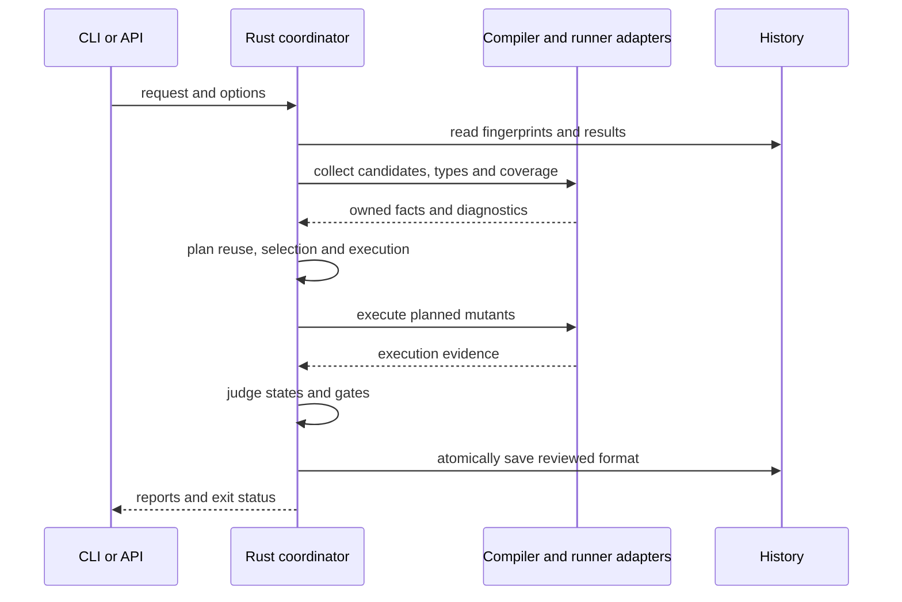

# ミューテーションの差分検証・再利用・追加ランナーの設計

## このドキュメントについて

[Requirements](requirements.md)と[Product](../../product.md)に従い、既存のRustによる候補生成と判定へ、反復検証の機能を追加します。

### 対象読者

変異の生成・実行・判定、追加ランナーと配布を実装する開発者。

### 前提知識

変異候補、基準実行、到達記録、入力の指紋、有限の状態分類。

### このドキュメントで扱わないこと

errspecの契約登録・失敗シナリオの条件は変更しません。

## 実装方針

Rustが実行要求を受け取り、設定の確定、候補の選択、型検査、履歴の照合、実行計画、判定、レポートを担当します。Node内のadapterはコンパイラやランナー固有の情報を取得し、所有可能な値を返します。既存の候補生成と非有効状態の切替は共用します。

追加機能は明示指定または追加設定で有効にします。従来の引数だけで起動した場合は、既存の結果形式と終了コードを維持します。新しい状態・理由・統計は省略可能な項目として追加し、未実行を検出済みへ変換しません。

### 型検査

型検査用の要求は、利用先のtsconfig、TypeScriptパッケージと変異候補を持ちます。TS 6はLanguageServiceのメモリ上の本文、TS 7は公式APIの仮想ファイルを使います。各候補へ元の本文から変更を適用し、診断の多重集合を元コードと比較します。新しい診断があればCompileErrorにし、元コードにもあった診断を変異によるエラーへ数えません。

候補間で本文を元へ戻し、finallyでコンパイラを解放します。noCheckは型検査として受け付けません。optional chainingの除外は、strictNullChecksとnoUncheckedIndexedAccessが成立し、受信式の型からnullとundefinedを除外できる場合に限ります。

### 履歴・差分・承認

履歴はエラー型のbaselineと別の版付き形式を使います。関数本文・テスト・依存・設定・環境・pluginの指紋、取得方式、結果と到達記録を保存します。位置を除いた変異識別子を照合し、入力または取得方式が異なる結果を再利用しません。保存は一時ファイルのrenameで行います。

cacheは明示した`--cache`／`cache`だけで有効にし、専用ディレクトリへ保存します。plain baselineは今回の実行から取り、初回の比較失敗または全選択テスト成功の結果だけを再利用します。候補key・到達テスト・選択テスト・取得方式と入力の指紋を一致させ、reusedを候補へ明示します。timeout、RuntimeError、再試行と型検査は再検査します。

probeの到達・感染記録は`coverage-v1.json`へ別のkindと取得方式で保存します。今回のplain baselineが成功し、入力・全テストのID／名前／file／状態／開始有無・候補参照が一致した場合にだけ再利用し、cache.coverageReusedを示します。task IDは今回の値へ結び直し、timeoutの基準は今回と以前の長い方を使います。不正な参照・件数・状態や削除テストがあれば全probeを取り直します。`--full-dry-run`／`fullDryRun`は結果cacheから独立してprobeを全実行し、`--no-full-dry-run`で設定のtrueを解除できます。

この指紋はビルド時に固定したRust・driver・依存lockとコンパイラ設定の識別子、Node/runtime・環境、実行設定、projectのファイル、今回取得したruntimeファイル、実際に解決したpackageとその内容を結びます。packageの循環と共有を扱い、すでに収集したpackageへの辺も同じ解決先へ結びます。cacheの自己出力と今回の一時ディレクトリを除外し、読み込みにくい入力は再利用しません。既定は同じcheckoutで入力が完全に一致する場合だけとし、位置だけの変更も再検査します。別checkoutと関数単位の再利用は下記の明示指定で扱います。

cacheが全件に命中しても、終了前にテストを実行せずファイル一覧を再収集します。実行後に指紋を再取得し、再利用中の入力変化を未完了にします。cacheの破損や証拠の不一致は今回の実行で検証し直します。保存は最終検証の後に一時ファイルからrenameし、人の承認を適用する前の比較結果を保存します。現在のquality gateと承認は再計算します。外部の制御されない状態に依存するテストはcacheの対象にしません。

解決済みのcompile値はViteのrootと各environmentから取得します。Vitestがdefineをruntime注入へ移す場合は解決済みdefinesも含め、設定ファイル本文が同じでも置換値、resolve、compiler、env、optimizerの変化で再検査します。実行時define script、opaqueなasset matcher、取得できていないtransform/load/resolve pluginや重複したbuiltin名、serializeできないcompiler値は再利用を停止します。CSS処理が無効な場合はVitestの解決済みCSS方針だけを使い、処理が必要でcallbackを含む場合はfreshへ戻します。project内部の既知pathだけを移設identityへ写し、defineの式・runtime値は書き換えません。

project移設は`--cache-relocation`／cacheRelocationの明示指定で許可し、既定は同じcheckoutに限定します。利用条件はproject絶対位置、cwd・PWD・INIT_CWDにテスト・依存の意味が依存しないことです。project内部のpathをtag付き相対identityへ変換し、package間の辺、runtimeと起動位置、既知のrunner setup pathにも同じ境界を適用します。外部path、その他の環境、provide値、設定の任意の値と全ファイル内容は一致を要求します。`..`を含む未解決pathを移設対象にしません。実行pathや利用先のコードは変換せず、指紋だけを変換し、mode自体も指紋とcache.relocationへ記録します。今回のordinary baseline・登録照合・task IDの再結合・終了時の実pathによる入力再取得を維持します。CI固有値が変わる場合も既定では再利用せず、cache保存だけで環境の同一性を推定しません。

Gitの基準と変更行を取得し、nodeまたはscope単位で候補を選択します。検出テストがなくなった候補を再検証へ含め、未収集の変更テストを診断します。callgraph選択は明示した実験的な指定に限定します。承認は識別子と理由の別データとし、古いIDを案内します。

Git差分の取得はproject rootを基準にし、指定したrevisionをcommitへ解決してから、staged・unstaged・未追跡のファイルを収集します。ファイル名はNUL区切り、pathspecはliteralで取得し、quoted pathや色付きの出力を解析しません。取得は30秒・各stream 16 MiBに制限し、中断と所有するprocess groupの終了は設定読み込みと共通の取得処理にします。

nodeは変異する式・文の範囲、scopeは最も近い名前付き関数・method・関数値bindingの範囲と変更行を照合します。module直下はmodule全体をscopeにします。`--only`との併用は積集合です。テストの変更・削除、候補inventory以外の変更は依存の影響を否定できないため全候補へ広げます。未収集の変更テストはquality gateと別のwarningとして報告します。実行後に差分を再取得し、取得開始時から変わった場合は完了にしません。この段階ではbaselineを毎回取り、永続的な再利用は別の機能として接続します。

関数単位の再利用に向け、所有されたsyntax metadataの内部版2は元のUTF-8ソースのSHA-256と、直接の関数bodyに対応するentry candidateを持ちます。native parserが取得し、Rustの共通境界で本文、候補のoriginal範囲、scopeのhashと親子関係、ASTの完全な木、entryの所有者・配置を検証します。取得後にソースが変われば入力変化として未完了にします。ネストしたcallbackのbodyを外側のentryへ流用せず、ignoredまたは生成対象外のguardはentryとして扱いません。

再利用モデルは全probeから今回のtest IDとfileを取得し、entryに到達したtest fileの集合をstatic hitも含めて作ります。entryのない関数を未使用とは見なしません。前後の変更scopeの集合が不明、entryが欠落、opaqueな呼出しがある場合は再検査し、既知の場合も前後の到達fileの和集合と候補の到達fileが重なれば再検査します。同じfileの異なるtest ID間の状態共有もこの単位で扱います。入力envelope・候補所有者・関数hash・選択テストを一致させ、既存cacheと同じ初回比較結果だけを適用します。既定は完全一致方式を維持し、`--cache --cache-scope`／cacheScopeでこの判定を実行計画へ接続します。`--no-cache-scope`で設定を解除します。deterministicな隔離済みtest fileを対象とし、source本文・位置・stack traceへの依存は対象外です。compiler commentの付着を取得できるまで、commentを持つfileのmodule envelopeにはraw本文も含め、位置変更でも再検査します。

独立したfunction ownerを持たない匿名default function宣言は、本文もmodule envelopeへ保持します。通常・async・generatorの匿名宣言を対象とし、名前付き関数のように本文を省略しません。

scope指紋は完全一致のraw指紋と一回の入力取得で作ります。inventory内の本文だけを検証済みmodule effectへ置き換え、test/helper・依存・設定・環境・package間の辺と外部runtime入力は同じ値を要求します。raw指紋が変われば全probeを取り直し、entry cohortを今回の候補へ結びます。別kindのscope-results-v1.jsonへ保存し、cache.scopeとscopeReusedを省略可能な統計として示します。未選択の古い記録はcontext全体が一致する場合だけ保持します。終了時は同じprojectionを用いてraw指紋を再取得し、実行中の変更を未完了にしてから保存します。

### weak mutationと除外

基準実行で到達と値の差を分けて取得します。値の差を確認できる式についてだけweak mutationを適用し、評価回数、受信オブジェクト、短絡を維持できない式は実行による検証へ進めます。arid、disable、Strykerコメント、pluginの除外は理由を候補へ含めます。

除外コメントはparserのtriviaから位置・本文を取得し、string・regex・template・JSX textの範囲と重なる偽指示を除きます。所有されたコメントの値をRustの純粋な判定へ渡し、`errspec-`／`mutator-`のdisable-next-line、disable-line、disable/enableと、Stryker disable/restoreを解釈します。line指定をregionより優先し、regionは指定familyごとの最後の指示を使います。next-lineは複数行commentの終了行の次、regionはcomment終了offsetから適用します。IDを維持してcandidate.ignoredへdisabledと任意の理由を入れ、既存のignored経路でinstrumentation・trial・score・gateから除きます。builtinの安全な除外は元の理由を優先します。指示の削除はproject入力の変化としてcacheを無効にし、再検査します。

aridは既存結果を維持するため既定offとし、`--arid`／設定・APIのaridで明示的に有効化します。`--no-arid`で設定のtrueを解除します。console/logger/logのreceiver、debug/traceのproperty、debug関数を既定とし、aridCalleesと反復可能な`--arid-callee`でpattern集合を置換します。空集合は一致なし、nullは既定へ戻す指定です。ASTからcalleeのdotted pathを取得し、computed accessやcastは照合しません。callと、それだけからなる非空block／ifをaridとしてmemo化し、candidateの祖先をたどります。mixed statement・宣言・return・function境界では伝播を止め、candidate.ignoredへ理由を入れます。明示commentとbuiltin理由を優先し、有効化とpatternはcache指紋に含めます。これはloggingに関する命名heuristicであり、引数・条件を含む副作用の同値性は保証しません。

### 独自mutatorとignorer

`plugins`はmodule文字列または`{module, settings}`の配列とし、CLIでは`--plugin`を繰り返します。相対moduleはproject root、package名はprojectのmodule解決を基準にします。moduleのdefault exportは`defineMutator`、`defineIgnorer`、`definePlugin`で定義したobjectまたはその配列です。定義helperは型付きidentity関数とし、callbackをJSONや生成した実行可能sourceへ変換しません。

Nodeはmoduleを取得し、Rustが取得した構文nodeのkind・親子関係・UTF-8位置・本文をvisitorへ渡します。mutatorは訪問node内の置換を返し、ignorerは除外理由を返します。Rustはnodeとrangeを照合し、置換後のファイルを再parseし、安全なruntime expression／statement／bodyへ配置して従来と同じIDを生成します。calleeやassignment referenceは全体のexpressionへ持ち上げます。型や宣言tokenなどruntime switchを置けないanchorはエラー、switch自体が成立しないcontextは理由付きのIgnoredとします。builtinと独自mutatorの名前は重複できず、`excludeMutator`で個別に除外できます。builtin安全規則、disable／Strykerコメント、arid、ignorerの順で理由を優先します。pluginの`aridCallees`は追加規則とし、`arid`が無効なら適用しません。

moduleのimport／requireとpackage manifestはNodeのmodule hookで取得し、世代中の内容変化を検査します。明示の`inputs`とcontextの`readInput`も同じ入力記録へ加えます。`cache: "deterministic"`は、取得済みmodule・settings・環境・追加入力から決定的に動くというplugin作者の契約です。時刻、乱数、未宣言の外部読取に依存するpluginは指定せず、cacheを保守的に無効化します。設定、plugin本体、依存module、追加入力の変更はnativeの指紋を変え、実行結果と到達記録を再取得します。scope cacheでもpluginの取得済み入力を省きません。

### ランナーと実行計画

`-j`／`--concurrency`と設定・APIの`concurrency`は1〜64の整数とし、既定1を維持します。2以上ではRustのqueueから各workerへ候補を割り当て、逐次実行と同じtrial・再確認・判定を使います。samplingとcache照合は配分前に行い、時間予算は要求全体の開始時刻で共有します。開始済みのtrialは完了させ、開始前の候補はPendingにします。完了順によらずinventory順へ結果を戻し、engine.parallelに要求数と起動したtrial worker数を示します。

各workerは独立したdriver・run ID・一時領域・所有process groupを持ち、追加workerは全probeを取り直します。テスト登録・状態・到達・感染をprimary probeと照合し、task IDと実行記録をworker内へ結びます。timeout再起動でもprobeを照合し直します。1workerの失敗はpeerを中断し、SIGINT／SIGTERM／親のSIGKILLは全所有groupを終了します。cache保存前には全workerのruntime入力を結合し、設定の差は保存を停止、入力内容の競合や再利用済み証拠の不一致は未完了にします。外部サービスの状態は隔離しないため、利用先は同時実行に耐えるテストを用意します。

`--shard INDEX/TOTAL`はGit・onlyの後の候補を、keyの先頭64-bit値modulo totalで分けます。設定・APIは`shard: {index,total}`とし、1始まりの範囲を検証します。選択と省略の件数・方式をreport.shardに示し、scoreとgateをその要求範囲に限定します。baseline／probeはproject全体、型検査とtrialはshard内です。共通cacheの指紋からshard指定を外し、全候補keyの記録を保持して逐次実行の結果を集めます。並行保存のatomicityは保ち、lost updateは再検査へ戻します。標本と予算は各shard呼出し内で適用します。

ランナー選択は`runner`（auto / vitest / vite-plus / jest / playwright）、`runnerConfig`、`runnerProject`、`runnerPackage`で受け取ります。既存のVitest指定も維持します。自動選択はrootのVitest/Vite設定、Jest設定またはpackage.jsonのjest、Playwright設定、導入済みpackageの順に確認します。ViteとPlaywright設定が共存する場合はPlaywrightを明示します。

Vitest、Jest、Playwrightは共通の実行要求と結果へ変換します。Jestはnative ESM、PlaywrightはViteとfixtureを使う方式に限定します。Jestは利用先のESM変換をwrapし、元ソースに共通emitterのswitchを適用してから変換します。変換未設定のTypeScriptはNodeの型除去を使います。共通generator、probe、Rustの試行と判定を共用し、ランナーごとの判定loopは作りません。Vite+は導入先が同梱するVitest 5の公開APIへ接続します。

Playwrightでは全projectを列挙し、projectを含むテストidentityを持ちます。各owned workerのVite serverを異なる一時portで起動し、利用先のfixtureを拡張できる自動fixtureでpage/frameの到達とinfectionを取得します。browser bindingでdocumentの破棄前に観測をNode側へ渡し、遷移後も保持します。fixtureを取得できなかった実行を検出にしません。追加adapterでは完全な外部入力を取得できるまでconfigurationHashをnullとし、結果と到達記録のキャッシュを再検証します。

各実行器は独立した状態を持ち、並列枠数、分割、標本、時間予算を実行計画へ反映します。予算で開始しなかった候補はPendingとし、標本と予算の理由を区別します。Pendingが残る場合は全体スコアをnullにし、break閾値とfail-on-undetectedを合格にしません。実行済みの一部だけで100%の全体判定を作りません。

Vitest sessionの再利用は`--reuse-session`／`reuseSession`で有効にし、既定はfreshとします。plain baselineは独立させ、probe以降のcontextだけを保持します。試行ごとにrequest・結果の格納先・provided context・test IDsを更新し、公開APIでテストファイルの収集cacheを消して再列挙します。workerはforks・isolateを維持し、timeoutは保存した初期値から毎回設定します。確認用の試行だけ3倍にし、次の候補へ持ち越しません。

ルートまたは選択projectにglobalSetupがある場合は、各試行のsetup・teardownを維持するためfreshにします。公開の収集cache初期化APIを持たない版もfreshとし、利用可能／globalSetup／API不足の理由をengine.sessionReuseへ示します。保持中のcontextへ実行外のeventや古いrequestのmetadataが届いた場合、今回の検出として数えず未完了にします。closeでは保持中のcontextを終了し、cleanupの失敗を成功に変換しません。

実行器は今回のプロセス群と所有情報を管理します。孤立プロセスの終了には保存した実行IDと起動情報の一致を必要とします。kill matrixでは途中の検出による省略を行わず、最初の検出で終了して得た結果をmatrixとして再利用しません。

Native supervisorをgroup leaderとし、Nodeは同じgroupとstdioを継承します。親はsupervisorをreapする前にgroupを終了し、supervisorはkernelの親関係が変わった場合に自分のgroupを終了します。privateなUID別registryには版・run ID・256-bit token・owner／supervisor・Unix endpointを保存します。次回の起動は3秒・256件まで照会し、生きているsupervisor自身が親とgroupを確認して終了します。保存PIDへ直接signalを送らず、active・不一致・未確認の記録を終了しません。Unix endpointが禁止された場合も親監視は維持し、workers.endpointUnavailableを示します。実行器と生成器のengine fingerprintも照合して、起動中のbinary差替えを未完了にします。

### レポート・API・配布

Rustの結果からtext、mutation-testing-elements形式、agent、simplify、テスト選択、kill matrixを生成します。表示とquality gateは別の判定にし、保存先とstdoutを区別します。追加のnpm APIは機械可読の内部要求を使い、CLI引数の解析を実装の契約に含めません。

Actionは基準の取得と履歴の復元・保存を行い、失敗時も保存します。Skillと初期生成は同じ導入・反復修正・Playwrightの手順を提供します。

## アーキテクチャ・シーケンス図

## データモデル・ER 図

変異識別子へ入力の指紋、到達テスト、検出テスト、判定状態と理由を関連付けます。履歴の版と取得方式を必須にし、互換性を確認できない履歴は再実行へ進めます。エラー型のシナリオ履歴とは別の形式です。

## API・インターフェース

既存のmutateの引数は維持し、型検査、差分、履歴、予算、追加ランナー、レポートの指定を追加します。型検査は--typecheck、--no-typecheck、--typecheck-project、--typecheck-packageで指定し、既存の--nodeを使います。意味解析用の--analysis-engineなどとは区別します。

mutation専用設定は`errspec.mutation.config.{ts,mts,mjs,js,json}`から1つを選び、`--config-file`で明示できます。親ディレクトリを探索せず、複数ある場合はエラーにします。設定ファイル全体を検証してから、明示されたCLI/APIのプロパティだけを上書きします。policyはプロパティ単位で、配列は置き換えます。否定フラグは設定のtrueを解除でき、型検査を無効にすると明示されなかったコンパイラパスも解除します。

設定のrootは設定ファイルからの相対パス、設定内のパスは有効なproject rootからの相対パスです。明示CLI/APIのroot・パスは呼び出し元ディレクトリを基準にします。script設定はNode 24のtype strippingで取得し、JSON互換のdefault exportを要求します。取得の期限は10秒、出力上限は1 MiBで、ログはstderrへ送ります。子をreapする前に所有するprocess groupを終了し、reap後のPIDへsignalを送りません。

共通の`mutation::options::Options`をCLIとAPIで使用します。`@errspec/core`の`runMutation`はprotocol 1のJSON要求をnative binaryへ送り、CLI解析を経由しません。`defineConfig`は型付きidentity関数で、最終的な入力検証と判定はRustが行います。設定・品質不合格はreportとexitCodeを返し、起動失敗や不正な応答はPromiseのrejectにします。公開型とJSON Schemaはpackageに同梱します。

内部要求と応答は版・実行ID・要求ID・件数を照合します。候補IDの欠落・重複・不一致、壊れた診断、実行していない対象の結果をエラーとします。型検査の状態は既存のengine.typecheckと追加の版情報で示します。

## 外部サービスとの連携方式

コンパイラとランナーは導入済みのパッケージを使います。GitHub Actionは公開のcheckout/cache機能を使用します。ローカル実行のためのソース送信や自動公開は行いません。

## データの取り扱い設計

型検査は仮想の本文で行い、元のファイルを変更しません。履歴、承認、レポートはそれぞれ用途と版を分けて保存します。設定とpluginの取得を、取得済み値に対する判定関数へ含めません。

## 認証認可に関する特記事項

ローカルの権限で実行します。GitHubの権限はActionの実行環境から受け取り、新たな秘密情報の保存は行いません。

## セキュリティ上の留意事項

実行器のプロセス群を限定して終了し、実行IDと所有情報が異なる過去のプロセスを終了しません。設定・pluginの評価は利用者のコードの実行として扱います。機械可読の出力へログを混ぜません。

## デプロイに関する特記事項

既存のCLIとtestkitの移行は不要です。追加したnpm APIとActionは配布前のローカル成果物から検証します。npm公開や支払い設定の変更は行いません。

## 検討した代替手段

### mutator 0.2.0全体を実行エンジンとして同梱する

固定版の機能を直接再利用できますが、oxcのネイティブ依存と別の判定モデルを配布へ追加します。既存のRustによる候補と判定を共用する方針を採用し、この案は利用者から指示があった場合に再検討します。

## 未決事項

機能の範囲に未決事項はありません。追加の実装方針について利用者から指示があれば反映します。
