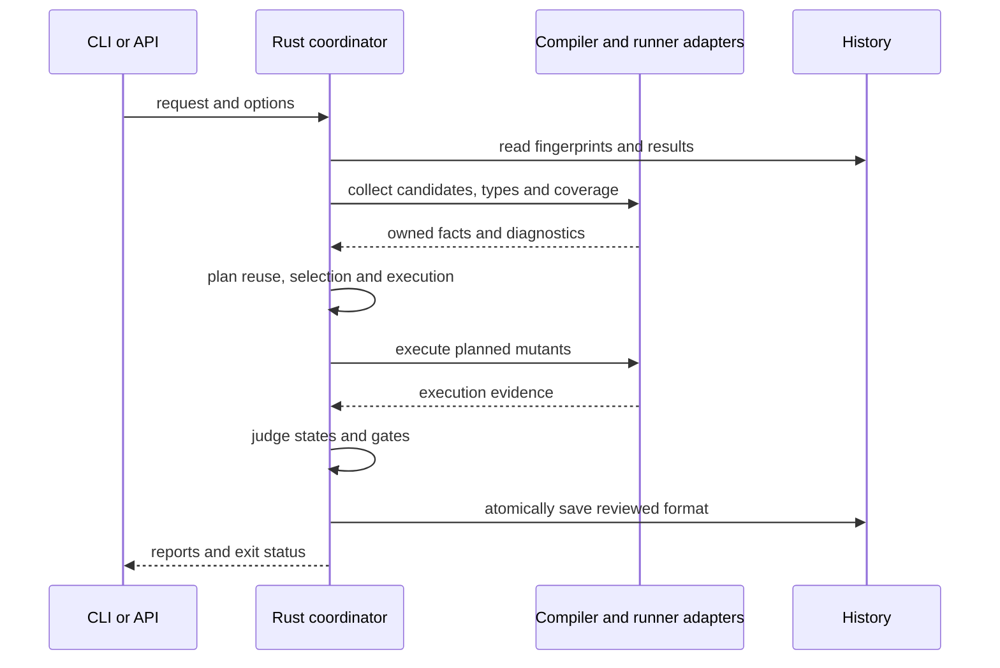

# ミューテーションの差分検証・再利用・追加ランナーの設計

## このドキュメントについて

[Requirements](requirements.md)と[Product](../../product.md)に従い、既存のRustによる候補生成と判定へ、反復検証の機能を追加します。

### 対象読者

変異の生成・実行・判定、追加ランナーと配布を実装する開発者。

### 前提知識

変異候補、基準実行、到達記録、入力の指紋、有限の状態分類。

### このドキュメントで扱わないこと

errspecの契約登録・失敗シナリオの条件は変更しません。

## 実装方針

Rustが実行要求を受け取り、設定の確定、候補の選択、型検査、履歴の照合、実行計画、判定、レポートを担当します。Node内のadapterはコンパイラやランナー固有の情報を取得し、所有可能な値を返します。既存の候補生成と非有効状態の切替は共用します。

追加機能は明示指定または追加設定で有効にします。従来の引数だけで起動した場合は、既存の結果形式と終了コードを維持します。新しい状態・理由・統計は省略可能な項目として追加し、未実行を検出済みへ変換しません。

### 型検査

型検査用の要求は、利用先のtsconfig、TypeScriptパッケージと変異候補を持ちます。TS 6はLanguageServiceのメモリ上の本文、TS 7は公式APIの仮想ファイルを使います。各候補へ元の本文から変更を適用し、診断の多重集合を元コードと比較します。新しい診断があればCompileErrorにし、元コードにもあった診断を変異によるエラーへ数えません。

候補間で本文を元へ戻し、finallyでコンパイラを解放します。noCheckは型検査として受け付けません。optional chainingの除外は、strictNullChecksとnoUncheckedIndexedAccessが成立し、受信式の型からnullとundefinedを除外できる場合に限ります。

### 履歴・差分・承認

履歴はエラー型のbaselineと別の版付き形式を使います。関数本文・テスト・依存・設定・環境・pluginの指紋、取得方式、結果と到達記録を保存します。位置を除いた変異識別子を照合し、入力または取得方式が異なる結果を再利用しません。保存は一時ファイルのrenameで行います。

Gitの基準と変更行を取得し、nodeまたはscope単位で候補を選択します。検出テストがなくなった候補を再検証へ含め、未収集の変更テストを診断します。callgraph選択は明示した実験的な指定に限定します。承認は識別子と理由の別データとし、古いIDを案内します。

### weak mutationと除外

基準実行で到達と値の差を分けて取得します。値の差を確認できる式についてだけweak mutationを適用し、評価回数、受信オブジェクト、短絡を維持できない式は実行による検証へ進めます。arid、disable、Strykerコメント、pluginの除外は理由を候補へ含めます。

### ランナーと実行計画

Vitest、Jest、Playwrightは共通の実行要求と結果へ変換します。Jestはnative ESM、PlaywrightはViteとfixtureを使う方式に限定します。各実行器は独立した状態を持ち、並列枠数、分割、標本、時間予算を実行計画へ反映します。予算で開始しなかった候補はPendingとし、標本と予算の理由を区別します。

実行器は今回のプロセス群と所有情報を管理します。孤立プロセスの終了には保存した実行IDと起動情報の一致を必要とします。kill matrixでは途中の検出による省略を行わず、最初の検出で終了して得た結果をmatrixとして再利用しません。

### レポート・API・配布

Rustの結果からtext、mutation-testing-elements形式、agent、simplify、テスト選択、kill matrixを生成します。表示とquality gateは別の判定にし、保存先とstdoutを区別します。追加のnpm APIは機械可読の内部要求を使い、CLI引数の解析を実装の契約に含めません。

Actionは基準の取得と履歴の復元・保存を行い、失敗時も保存します。Skillと初期生成は同じ導入・反復修正・Playwrightの手順を提供します。

## アーキテクチャ・シーケンス図

## データモデル・ER 図

変異識別子へ入力の指紋、到達テスト、検出テスト、判定状態と理由を関連付けます。履歴の版と取得方式を必須にし、互換性を確認できない履歴は再実行へ進めます。エラー型のシナリオ履歴とは別の形式です。

## API・インターフェース

既存のmutateの引数は維持し、型検査、差分、履歴、予算、追加ランナー、レポートの指定を追加します。型検査は--typecheck、--no-typecheck、--typecheck-project、--typecheck-packageで指定し、既存の--nodeを使います。意味解析用の--analysis-engineなどとは区別します。

内部要求と応答は版・実行ID・要求ID・件数を照合します。候補IDの欠落・重複・不一致、壊れた診断、実行していない対象の結果をエラーとします。型検査の状態は既存のengine.typecheckと追加の版情報で示します。

## 外部サービスとの連携方式

コンパイラとランナーは導入済みのパッケージを使います。GitHub Actionは公開のcheckout/cache機能を使用します。ローカル実行のためのソース送信や自動公開は行いません。

## データの取り扱い設計

型検査は仮想の本文で行い、元のファイルを変更しません。履歴、承認、レポートはそれぞれ用途と版を分けて保存します。設定とpluginの取得を、取得済み値に対する判定関数へ含めません。

## 認証認可に関する特記事項

ローカルの権限で実行します。GitHubの権限はActionの実行環境から受け取り、新たな秘密情報の保存は行いません。

## セキュリティ上の留意事項

実行器のプロセス群を限定して終了し、実行IDと所有情報が異なる過去のプロセスを終了しません。設定・pluginの評価は利用者のコードの実行として扱います。機械可読の出力へログを混ぜません。

## デプロイに関する特記事項

既存のCLIとtestkitの移行は不要です。追加したnpm APIとActionは配布前のローカル成果物から検証します。npm公開や支払い設定の変更は行いません。

## 検討した代替手段

### mutator 0.2.0全体を実行エンジンとして同梱する

固定版の機能を直接再利用できますが、oxcのネイティブ依存と別の判定モデルを配布へ追加します。既存のRustによる候補と判定を共用する方針を採用し、この案は利用者から指示があった場合に再検討します。

## 未決事項

機能の範囲に未決事項はありません。追加の実装方針について利用者から指示があれば反映します。
