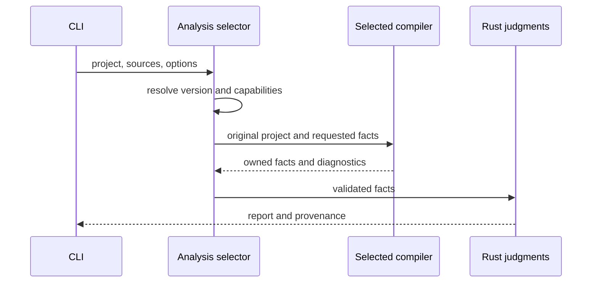

# TypeScript 6・7の解析backend選択の設計

## このドキュメントについて

[Requirements](requirements.md)と[Product](../../product.md)に対応し、コンパイラ固有の値を各backend内へ限定します。

### 対象読者

解析器とCLIを実装・変更する開発者。

### 前提知識

型とシンボル、AST、コンパイラの診断とerrspecの判定の違い。

### このドキュメントで扱わないこと

変異後の型検査と変異の生成規則は扱いません。

## 実装方針

Rustの解析窓口が、tsrsまたはNode内の公式APIを選択します。NodeにはTS 6の従来のCompiler APIとTS 7の`unstable/sync`用adapterを設けます。両者の結果は所有可能な値に変換し、Rustのタグ照合、伝播、静的照合、レポートを共用します。

自動選択では、プロジェクトのディレクトリと親の`node_modules/typescript/package.json`を探索します。TS 6・7が見つかれば利用先のAPIを選び、未導入または他の版の場合は従来のtsrsを使います。明示指定は自動選択より優先します。必要なAPIがない場合はEC_ANALYSIS_BACKENDで停止します。

先に版を確認するのは、tsrsでエラーが発生しなくても、版の違いによって型解釈や解決先が異なることがあるためです。backend内のコンパイラ診断を単に無視するfallbackは設けません。

### 事実と判定

- タグ抽出は、alias解決と有限の文字列集合の確認を各コンパイラで行います。
- 走査は、関数・発生元・呼出辺・未解決箇所を`ScanFacts`として返します。固定点の計算と結果の順序は既存のRustを利用します。
- 登録テストのASTから、識別値、位置、describe内への登録かどうか、fault/checkのIDを取得します。EC015・EC016・EC017の比較は共通のRustで行います。
- Nativeな型、シンボル、ASTハンドルをNodeとRustの境界へ含めません。

### 位置と順序

相対パス、UTF-8 byte offset、LFに基づく既存の行番号を維持します。各APIのAST位置の単位を確認し、UTF-16の場合は元ソースからbyte offsetへ変換します。BOMやCRLFも元のファイルに照合します。byte offsetはtsrsの既存の定義に従い、先頭のUTF-8 BOMを除いた本文で数えます。関数・辺・発生元の順序は既存の走査規則に従います。

## アーキテクチャ・シーケンス図

## データモデル・ER 図

単一の要求と応答で表せるためER図は省略します。応答はprotocol version、実際のengineと版、診断、タグ要求ごとの結果、任意の走査事実、静的照合の事実を持ちます。応答の欠落・重複・不明な要求IDは通信エラーです。

既存レポートには省略可能な`analysis`を追加します。tsrsの既定経路では省略し、従来のJSONを維持します。公式API使用時は`engine`、`version`、`package`、`reason`を記録します。契約レポートの既存`engine`も実際の解析先を表します。

## API・インターフェース

`--analysis-engine auto|tsrs|typescript`、`--typescript-package PATH`、`--analysis-node PATH`を型解析を使うコマンドで受け付けます。既定はautoとPATH上のnodeです。明示パスは呼出元から解決します。`mutate`は意味解析の指定を受け付けず、既存の`--node`を維持します。

Node bridgeはJSON要求をstdinで受け取り、結果だけをstdoutへ返します。診断とログを混ぜません。Rustはbridgeをバイナリへ同梱して一時ディレクトリから起動します。APIパッケージは絶対パスで解決し、bundleや自動取得は行いません。

## 外部サービスとの連携方式

ネットワークは使いません。TS 6.0.3のCompiler APIとTS 7.0.2の`unstable/sync`を比較の基準にします。TS 7 APIは変更の可能性があるため、APIの存在確認と対応版ごとの比較を必要とします。

## データの取り扱い設計

要求ごとにプロジェクトを開き、結果を値へ変換して終了します。Nodeのsnapshot/APIはfinallyで解放します。Rustは一時ファイルと起動したプロセスを所有し、応答待ちと終了を管理します。待機は300秒、stdoutは64 MiB、stderrは4 MiBを上限とし、超過・SIGINT・SIGTERMでは未完了を返してプロセス群を終了します。実行間のキャッシュは設けません。

## 認証認可に関する特記事項

なし。利用者のローカル権限で導入済みのパッケージを参照します。

## セキュリティ上の留意事項

shellを使わず実行ファイルと引数を配列で渡します。応答の形式と要求との対応を検証します。実行器の失敗を空の成功結果へ変換しません。

## デプロイに関する特記事項

利用先の設定やシナリオ履歴の移行は不要です。既存のtsrsだけの利用はNodeを要求しません。公式APIを選ぶ場合にNodeと対応するTypeScriptを必要とします。

## 検討した代替手段

### 設定だけを別の値へ変更する

`node10`を`bundler`として扱う方法では、条件付きexportsなどの解決規則まで同じにはできません。公式APIの利用により元の設定と解決結果を維持します。

### tscの終了コードだけで代替する

型検査の成否は得られますが、タグ、呼出先、型に基づく静的照合の情報が必要なため、解析用APIを使います。

## 未決事項

なし。未確認の版への対応はAPIの確認と比較結果を前提に拡大します。
