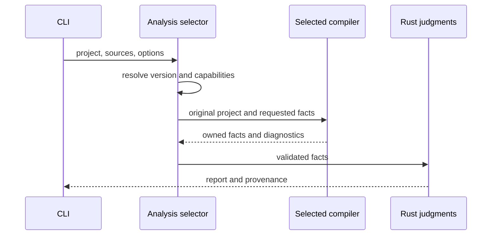

# TypeScript analysis-backend design

## About this document

This implements the [Requirements](requirements.md) under the [Product](../../product.md),
keeping compiler-specific handles inside adapters. It is for analysis/CLI maintainers
who distinguish compiler diagnostics from errspec judgments. Mutation generation
and mutant typechecking remain separate.

## Selection

The Rust entry chooses tsrs or official APIs in Node. Node adapters support TS 6's
traditional Compiler API and TS 7's `unstable/sync`. Convert responses to owned
values and share Rust tag matching, propagation, static matching and reports.

Automatic selection searches the project and parents for
`node_modules/typescript/package.json`. Select official APIs for TS 6/7; preserve
tsrs for absent or other-major installations. Explicit selection wins. Missing
required APIs produce `EC_ANALYSIS_BACKEND`. Check version first because tsrs may
succeed while resolving types differently; do not hide diagnostics with fallback.

## Owned facts and positions

- Each compiler resolves aliases and finite string sets for tag extraction.
- Return functions, origins, edges and unresolved sites as `ScanFacts`, sharing
  existing Rust fixed-point calculation and ordering.
- Acquire registration discriminator values, positions and fault/check IDs from
  test ASTs; share Rust `EC015`/`EC016`, including registrations inside describe.
- Resolve entry exports/aliases into function IDs, return positions and tags.
  Rust filters contract tags and uses shared propagation for `EC018`; Bun line
  coverage matching shares `EC019`. Validate request IDs/counts/function references
  so missing paths cannot become empty success.
- Acquire declaration-based re-export grouping, external discriminator declarations
  and error declaration/channel relationships for scan.
- Never send compiler-native type/symbol/AST handles across Node/Rust boundaries.

Keep relative paths, UTF-8 byte offsets and existing LF-based line numbering.
Check each API's position unit and convert UTF-16 from original source. Match BOM
and CRLF against that source. Existing tsrs offsets count the text after removal
of a leading UTF-8 BOM. Preserve function/edge/origin traversal order.

## Flow

## Protocol and interfaces

A request/response pair needs no ER diagram. Responses carry protocol version,
actual engine/version, diagnostics, per-tag-request results, optional scan facts
and static-match facts. Missing, duplicate or unknown request IDs are protocol
errors.

Optional `analysis` is omitted on the default tsrs path to preserve native JSON.
Official API results record `engine`, `version`, `package`, `reason`; the existing
contract `engine` also identifies the actual provider.

Semantic commands accept `--analysis-engine auto|tsrs|typescript`,
`--typescript-package PATH`, `--analysis-node PATH`, defaulting to auto and node
on PATH. Explicit paths resolve from the caller. `mutate` rejects semantic-analysis
options and retains its own `--node`.

The bundled Node bridge receives JSON stdin and returns results only on stdout,
without mixed logs. Rust extracts it to a temporary directory and resolves API
packages by absolute path; do not bundle or download the compiler package.

## Lifecycle and safety

Use no network. TS 6.0.3 Compiler API and TS 7.0.2 `unstable/sync` are the comparison
baseline; the unstable API needs capability checks and per-version comparison.
Open a project per request, convert results to values and close it. Release Node
snapshots/APIs in `finally`; Rust owns temporary files and child-process lifetime.
The bridge delegates bounded command acquisition to `owned_process`, which also
serves Git and configuration loading. The analysis adapter supplies JSON stdin,
separate stream limits and its interruption predicate, and maps acquisition
failures to the existing analysis diagnostics. The common owner stops the group
before reaping its child, including normal completion and early failures.
Bound waits to 300 seconds, stdout to 64 MiB and stderr to 4 MiB. Limits or
SIGINT/SIGTERM produce incomplete results and terminate the process group. There
is no between-run cache.

Use the consumer's local permissions, direct executable/argument arrays rather
than a shell, and response/request validation. Never convert runner failure into
empty success. No project-config or scenario-history migration is required.
Tsrs-only use still needs no Node; selecting official APIs requires Node and the
corresponding installed TypeScript.

## Alternatives

Treating `node10` as `bundler` cannot preserve conditional exports and other
resolution rules. Use the official API for original configuration semantics.
A tsc exit code supplies typecheck success but not tags, callees or typed static
matching facts, so compiler analysis APIs are needed. New version support requires
capability checks and comparison; no other feature-scope decision is unresolved.
